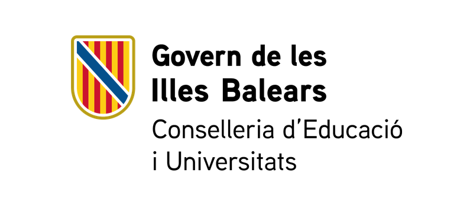
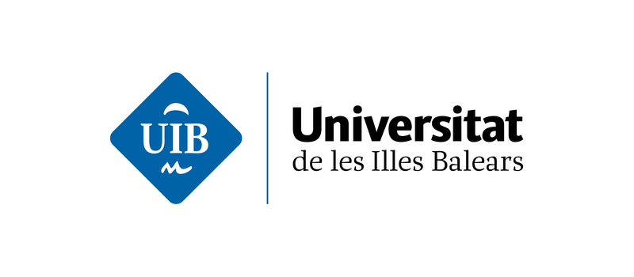
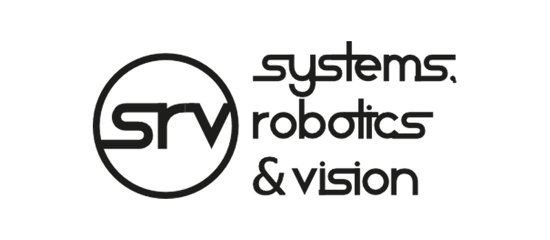
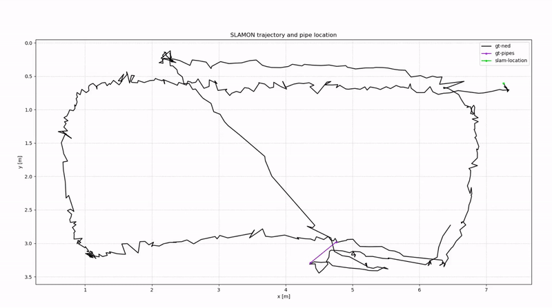
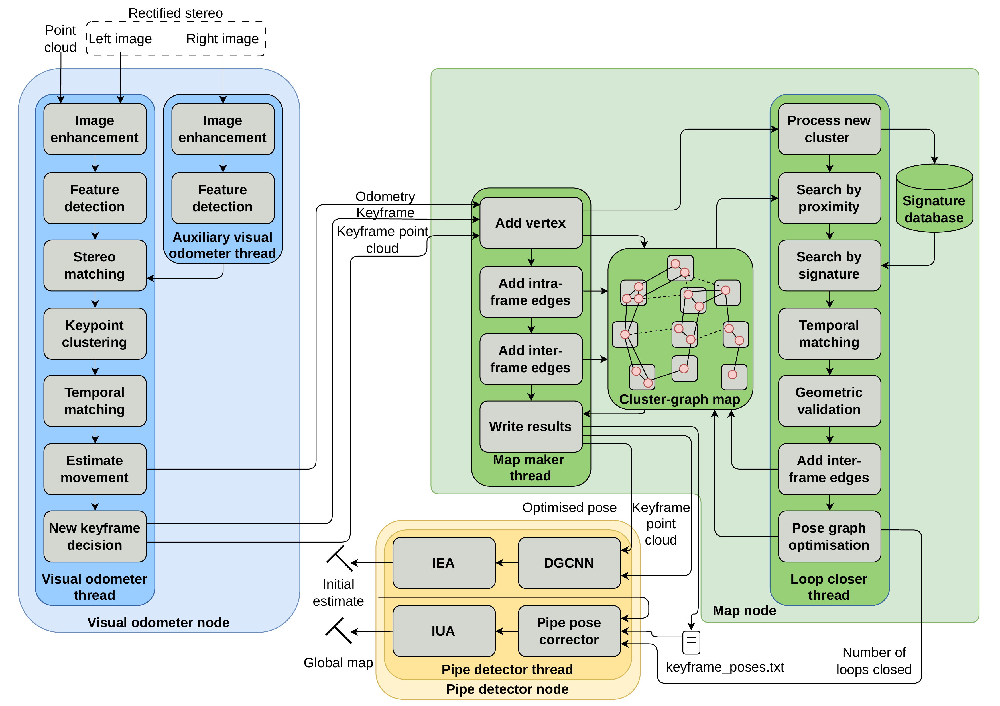

<p align="center">
  <picture class="logo-goib">
    <source media="(prefers-color-scheme: dark)" srcset="assets/logo_goib_dark.png">
    
  </picture>
  <picture class="logo-uib">
    <source media="(prefers-color-scheme: dark)" srcset="assets/logo_uib_dark.png">
    
  </picture>
  <picture class="logo-srv">
    <source media="(prefers-color-scheme: dark)" srcset="assets/logo_srv_dark.png">
    
  </picture>
</p>

<h3 align="center"><strong>SLAMON: a precise and robust stereo Visual SLAM for inspection tasks in underwater environments</strong></h3>

<p align="center">
  <a href="https://scholar.google.com/citations?user=gtafXmUAAAAJ&hl=es">Bo Miquel Nordfeldt-Fiol</a><sup>1</sup>,
  <a href="https://scholar.google.com/citations?user=WhE_DS8AAAAJ&hl=es">Miguel Martin-Abadal</a><sup>1</sup>,
  <a href="https://scholar.google.com/citations?user=RgPwmD4AAAAJ&hl=es">Francisco Bonin-Font</a><sup>1</sup>
  <br><br>
  <sup>1</sup> Systems, Robotics & Vision Group (SRV), Departament de Ciències Matemàtiques i Informàtica<br>
  Universitat de les Illes Balears, Spain
  <br>
</p>

<div align="center">
  <a href="#"></a> &nbsp;&nbsp;&nbsp;&nbsp;&nbsp;
  <a href="#"></a> &nbsp;&nbsp;&nbsp;&nbsp;&nbsp;
  <a href="#"></a> &nbsp;&nbsp;&nbsp;&nbsp;&nbsp;
  <a href="https://github.com/bomiquel/slamon/blob/noetic/LICENSE"></a> &nbsp;&nbsp;&nbsp;&nbsp;&nbsp;
  <a href="https://www.youtube.com/watch?v=G6NhKJ459Rw&t=1s"></a> &nbsp;&nbsp;&nbsp;&nbsp;&nbsp;
  <br>
  <br>
</div>

<p align="center">
  <a href="https://www.youtube.com/watch?v=G6NhKJ459Rw&t=1s">
    
  </a>
  <br>
  <em>Click on the GIF to watch the full video execution on YouTube.</em>
</p>


## Overview

As the underwater industry shifts Inspection, Maintenance, and Repair (IMR) tasks towards Autonomous Underwater Vehicles (AUVs), robust self-localization and precise mapping in complex subsea environments remain significant challenges. 

**SLAMON** is a precise and robust stereo Visual SLAM (V-SLAM) framework designed specifically for underwater scenarios where the vehicle navigates quasi-parallel to a dominant surface (e.g., the seabed or vertical offshore structures). Its primary objective is to generate a consistent 2D map to precisely localize objects of interest for subsequent intervention.

Built upon the foundations of [`stereo_slam`](https://github.com/srv/stereo_slam), the system employs SIFT features across all tasks and operates across three main parallel threads:

1. **Visual Odometry:** A configurable stereo visual odometer featuring CLAHE image enhancement, spatial keypoint clustering, and RANSAC-based 3D-to-2D motion estimation. It offers the option to choose between four outlier rejection methods during visual matching (`ratio`, `homography`, `circular-ratio`, `circular-homography`) and three motion estimators (`P3P`, `AP3P`, `EPnP`), resulting in twelve possible system versions.
2. **Mapmaker:** A topological-metric pose-graph mapmaker (wrapped around [`g2o`](https://github.com/RainerKuemmerle/g2o)) that constructs a cluster-graph map. Vertices represent keypoint clusters and edges encode 6-DoF relative motion constraints.
3. **Loop Closure:** A multi-cluster loop closer that detects revisited underwater areas using spatial proximity and [`HALOC`](https://github.com/srv/libhaloc) hash signatures. It performs Pose-Graph Optimization (PGO) to globally correct the map.


### Repository branches

To keep the codebase modular and easy to integrate, this repository is divided into two main branches:

*   [**`noetic`**](https://github.com/bomiquel/slamon/tree/noetic): Contains the **pure stereo V-SLAM** framework. Ideal if you only need robust underwater localization and mapping without any external AI dependencies.
*   [**`noetic-pipes`**](https://github.com/bomiquel/slamon/tree/noetic-pipes): Contains the stereo V-SLAM + the integration and coupling logic. The actual 3D deep-learning pipe and valve detector runs independently and can be found in the [**`dgcnn`**](https://github.com/mmabadal/dgcnn/tree/ros_uji) repository.

### Architecture pipeline

<p align="center">
  
</p>

### Project structure

```text
slamon/
├── .gitignore       # Git untracked files and build artifacts to ignore
├── .vscode/         # Visual Studio Code workspace configuration
├── assets/          # Documentation figures
├── CMakeLists.txt   # CMake build configuration
├── cmake-modules/   # Custom CMake modules for finding external libraries (e.g., G2O)
├── config/          # YAML configuration files for SLAMON parameters
├── include/         # C++ header files (.hpp)
├── launch/          # ROS 1 launch files
├── LICENSE          # BSD 4-Clause License
├── msg/             # Custom ROS 1 message definitions
├── NOTICE           # Copyright and attribution notices for third-party/legacy code
├── package.xml      # ROS 1 package metadata and dependencies
├── README.md        # Project documentation
├── scripts/         # Bash scripts for profiling
├── src/             # C++ source files (.cpp)
└── srv/             # Custom ROS 1 services definitions
```

## Set up

### Dependencies

To run SLAMON, you will need a system running **Ubuntu 20.04** with the following libraries:
* ROS Noetic
* OpenCV 4.2.0 + contrib modules (required for non-free SIFT features)
* G2O
* Eigen3
* SuiteSparse
* cmake_modules (ROS)


### Installation 

#### 0. Install dependencies

<details>
<summary> Click here to expand full installation instructions for OpenCV and ROS dependencies </summary>
<br>

**ROS NOETIC:**
```bash
# 0. Setup your sources.list
sudo sh -c 'echo "deb http://packages.ros.org/ros/ubuntu $(lsb_release -sc) main" > /etc/apt/sources.list.d/ros-latest.list'

# 1. Setup your keys
sudo apt -y install curl
curl -s https://raw.githubusercontent.com/ros/rosdistro/master/ros.asc | sudo apt-key add -

# 2. Keep ubuntu up to date
sudo apt -y update
sudo apt -y upgrade

# 3. Install ROS Noetic
sudo apt -y install ros-noetic-desktop-full

# 4. Install catkin tools
sudo apt -y install python3-catkin-tools
```

**OPENCV-4.2.0 WITH CONTRIB MODULES:**
```bash
# 0. Keep ubuntu or debian up to date
sudo apt -y update
sudo apt -y upgrade

# 1. Install the dependencies.
# Build tools:
sudo apt-get install -y build-essential cmake

# GUI:
sudo apt-get install -y libgtkglext1-dev libvtk6-dev

# Media I/O:
sudo apt-get install -y zlib1g-dev libjpeg-dev libwebp-dev libpng-dev libtiff5-dev libopenexr-dev libgdal-dev libgphoto2-dev

# Video I/O:
sudo apt-get install -y libdc1394-22-dev libavcodec-dev libavformat-dev libswscale-dev libtheora-dev libvorbis-dev libxvidcore-dev libx264-dev yasm libopencore-amrnb-dev libopencore-amrwb-dev libv4l-dev libxine2-dev v4l-utils

# Parallelism and linear algebra libraries:
sudo apt-get install -y libtbb-dev libeigen3-dev

# Python:
sudo apt-get install -y python-dev python-tk python-numpy python3-dev python3-tk python3-numpy

# 2. Install the library
sudo apt-get install -y unzip wget
wget https://github.com/opencv/opencv/archive/refs/tags/4.2.0.zip -O opencv420.zip
unzip opencv420.zip
rm opencv420.zip
mv opencv-4.2.0 OpenCV420
cd OpenCV420
touch OpenCV420withContrib

# 3. Install the opencv_contrib library
wget https://github.com/opencv/opencv_contrib/archive/refs/tags/4.2.0.zip -O opencv_contrib420.zip
unzip opencv_contrib420.zip
rm opencv_contrib420.zip
mv opencv_contrib-4.2.0 OpenCV420_contrib

# 4. Build OpenCV with contrib
## Fix Flow control statements are not properly nested issue
sed -i '21,22 s/^/#/' cmake/OpenCVCompilerOptions.cmake
## Fix ffmpeg version issue
sed -i '1 i #define AV_CODEC_FLAG_GLOBAL_HEADER (1 << 22)\n#define CODEC_FLAG_GLOBAL_HEADER AV_CODEC_FLAG_GLOBAL_HEADER\n#define AVFMT_RAWPICTURE 0x0020' modules/videoio/src/cap_ffmpeg_impl.hpp
## Fix build.make:56 Error
sed -i 's/PyString_AsString(obj);/(char*)PyString_AsString(obj);/' modules/python/src2/cv2.cpp
## Requires version 10 or lower
if [[ `gcc -dumpversion` -ge 11 ]]; then
    sudo apt-get install -y gcc-10 g++-10 libtbb2-dev
    CC="gcc-10"
    CXX="g++-10"
fi

mkdir build
cd build
CC=${CC} CXX=${CXX} cmake -DOPENCV_ENABLE_NONFREE=ON -DOPENCV_EXTRA_MODULES_PATH=../OpenCV420_contrib/modules -DCMAKE_INSTALL_PREFIX=/usr/local -DCMAKE_BUILD_TYPE=RELEASE -DWITH_QT=OFF -DWITH_OPENGL=ON -DFORCE_VTK=ON -DWITH_TBB=ON -DINSTALL_C_EXAMPLES=ON -DINSTALL_PYTHON_EXAMPLES=ON -DWITH_GDAL=ON -DWITH_XINE=ON -DBUILD_EXAMPLES=OFF -DENABLE_PRECOMPILED_HEADERS=OFF ..
CC=${CC} CXX=${CXX} make -j`nproc`
sudo make install # Optional
sudo ldconfig # Only needed if sudo make install
```

**G2O, SUITESPARSE & CMAKE-MODULES:**
```bash
sudo apt install ros-noetic-libg2o ros-noetic-cmake-modules libsuitesparse-dev
```
</details>

#### 1. Create catkin workspace
```bash
mkdir -p ~/catkin_ws/src
cd ~/catkin_ws/src
catkin build
cd ..
source devel/setup.bash
```

#### 2. Clone and compile SLAMON
```bash
cd ~/catkin_ws/src
git clone -b noetic https://github.com/bomiquel/slamon.git # Clone the pure V-SLAM branch (use -b noetic-pipes for the detector integration branch)
catkin build slamon
source ~/catkin_ws/devel/setup.bash
```

## Datasets

To evaluate the system, we publicly release six underwater stereo datasets recorded in both controlled water tank (UJI datasets) and real shallow-sea (Cabrera datasets) scenarios. The datasets are provided as ROS bagfiles (`.bag`) and can be downloaded from **[Zenodo Link - TBA]**.

Depending on the scenario, three types of ground-truth (GT) references are provided:
- **Trajectory GT - UJI datasets:** A large seafloor poster with known dimensions was placed at the bottom of the water tank, allowing full 2D trajectory ground-truth generation, by image registration, to compute the Absolute Trajectory RMSE (ATRMSE).
- **Pipe GT - UJI datasets:** Images in which pipes were visible were aligned with the reference poster, allowing all pixels to be referenced to the poster's coordinate frame. Subsequently, key structural features (such as pipe-branch endpoints and junctions) were manually selected to define the ground-truth positions of the pipes.
- **Trajectory GT - Cabrera datasets:** In real sea trials where full trajectory GT is unavailable, a visual marker was placed on the seabed to define a common start and end point, enabling the evaluation of the 2D Last Position Error (LPE).

| Name | Env. | Dur. (s) | Path (m) | Alt. (m) | Dep. (m) | Stereo imgs. | Img. size (px) | Type | GT | Mode | Pipe type |
| :---: | :---: | :---: | :---: | :---: | :---: | :---: | :---: | :---: | :---: | :---: | :---: |
| **UJI-0** | Water tank | 363 | 43.7 | 1.6 | 3.2 | 726 | 1536×2048 | Color | Poster | Teleop. | Straight-pipe |
| **UJI-1** | Water tank | 205 | 29.8 | 1.6 | 3.2 | 411 | 1536×2048 | Color | Poster | Teleop. | Straight-pipe |
| **UJI-2** | Water tank | 232 | 37.2 | 1.6 | 3.2 | 466 | 1536×2048 | Color | Poster | Teleop. | T-pipe |
| **UJI-3** | Water tank | 229 | 38.6 | 1.7 | 3.1 | 459 | 1536×2048 | Color | Poster | Teleop. | T-pipe |
| **Cabrera-0** | Sea (shallow) | 239 | 82.5 | 3.0 | 4.8 | 477 | 1464×1936 | Color | Marker | Auto. | — |
| **Cabrera-1** | Sea (shallow) | 561 | 185.2 | 2.5 | 4.0 | 1122 | 1464×1936 | Color | Marker | Auto. | — |


## Configuration, usage, inputs & outputs

### Configuration parameters (`config/`)

All algorithmic parameters are centralized in YAML files located in the `config/` directory. The main parameters are as follows:

* `enable_debugging` (bool) - Flag to enable or disable debugging outputs and image saving.
* `lc_candidates` (int) -  Number of candidate clusters to compare with the query cluster for loop closure.
* `lc_discard_window` (int) - Window size of recent graph vertices (clusters) discarded from candidate search.
* `lc_neighbors` (int) - Number of neighboring clusters around each candidate to retrieve to increase loop closure probability.
* `matching_type` (str) - String identifier of the desired matching strategy (`ratio_matching`, `homography_matching`, `circular_ratio_matching` & `circular_homography_matching`).
* `min_inliers` (int) - Minimum number of geometric inliers required to accept a motion estimate.
* `min_lc_inliers` (int) - Minimum number of geometric inliers required to accept a loop closure.
* `motion_estimation_type` (str) - String identifier of the desired PnP motion estimation algorithm (`epnp`, `p3p` & `ap3p`).
* `robot_frame_id` (str) - Name of the robot base coordinate frame (e.g., `base_link`).
* `working_path` (str) - Working directory path for storing output logs, temporary files, and debug data.

It is recommended not to modify the remaining parameters and constants.

### Usage

The provided launch files in `launch/` are self-contained and handle the entire execution pipeline, including playing the ROS bagfiles, setting `frame_id`s, publishing static `tf` transforms between the robot and the stereo camera, defining initial poses, loading the parameter files from `config/`, and launching the SLAMON ROS nodes.

Simply update the bagfile path inside your desired launch file (based on the templates in `launch/`) and run:

```bash
roslaunch slamon launch_file_name.launch
```

### Inputs

#### VO node

* `left_camera_info` (ROS topic) - Intrinsic calibration parameters for the left camera.
* `left_image_rect_color` (ROS topic) - Rectified color image from the left camera.
* `right_camera_info` (ROS topic) - Intrinsic calibration parameters for the right camera.
* `right_image_rect_color` (ROS topic) - Rectified color image from the right camera.

#### Map node

* `slamon_vo/keyframe` (ROS topic) - Selected keyframe data published by the VO node.
* `slamon_vo/odom` (ROS topic) - Visual odometry estimate published by the VO node.

### Outputs

#### VO node

* `slamon_vo/camera_odom` (ROS topic) - Accumulated 6-DoF camera odometry pose and velocity twist.
* `slamon_vo/inliers_img` (ROS topic) - Image displaying the motion estimation inliers *(debugging mode only)*.
* `slamon_vo/inliers_num` (ROS topic) - Number of motion estimation inliers at the current frame.
* `slamon_vo/keyframe` (ROS topic) - Newly selected keyframe data sent to the Map node.
* `slamon_vo/keyframe_insertion_decision_img` (ROS topic) - Image displaying the inliers between the last keyframe and the current frame *(debugging mode only)*.
* `slamon_vo/robot_odom` (ROS topic) - Accumulated 6-DoF robot odometry pose and velocity twist.
* `slamon_vo/stereo_keypoints_img` (ROS topic) - Image displaying the detected stereo keypoints *(debugging mode only)*.
* `slamon_vo/stereo_matches_img` (ROS topic) - Image displaying the stereo keypoint matches *(debugging mode only)*.
* `slamon_vo/stereo_matches_num` (ROS topic) - Number of stereo matches at the current frame.
* `slamon_vo/temporal_matches_img` (ROS topic) - Image displaying the temporal matches between consecutive frames *(debugging mode only)*.
* `slamon_vo/temporal_matches_num` (ROS topic) - Number of temporal matches at the current frame.
* `slamon_vo/vo_performance` (ROS topic) - Per-iteration visual odometry execution times.

#### Map node — Mapmaker thread

* `slamon_map/camera_map` (ROS topic) - Map-corrected 6-DoF camera pose.
* `slamon_map/keyframe_num` (ROS topic) - Total number of keyframes currently in the map.
* `slamon_map/keypoints_clustering_img` (ROS topic) - Image displaying the spatially clustered keypoints of a keyframe *(debugging mode only)*.
* `slamon_map/mapmaker_performance` (ROS topic) - Per-iteration mapmaker execution times.
* `slamon_map/robot_map` (ROS topic) - Map-corrected 6-DoF robot pose.
* `clusters` (Image folder) - Directory where the algorithm saves each keyframe image with its clustered keypoints *(debugging mode only)*.
* `keyframes` (Image folder) - Directory where the algorithm saves each raw keyframe image *(debugging mode only)*.
* `keyframes_poses` (Text file) - Output log containing the list of stamped 6-DoF keyframe poses.
* `loop_closure_edges` (Text file) - Output log containing the list of loop closure graph edges and their relative poses.

#### Map node — Loop Closer thread

* `slamon_map/cluster_num` (ROS topic) - Total number of keypoint clusters in the pose graph.
* `slamon_map/loop_closer_performance` (ROS topic) - Per-iteration loop closer execution times.
* `slamon_map/loop_closure_img` (ROS topic) - Image displaying a detected loop closure and its matched features *(debugging mode only)*.
* `slamon_map/loop_closure_inliers_num` (ROS topic) - Number of geometric inliers between the query and candidate clusters for loop closure.
* `slamon_map/loop_closure_matches_num` (ROS topic) - Number of descriptor matches between the query and candidate clusters for loop closure.
* `slamon_map/loop_closure_num` (ROS topic) - Total number of accepted loop closures.
* `haloc` (Temporary folder) - Working directory where the algorithm stores each cluster data 
* `loop_closures` (Image folder) - Directory where the algorithm saves images with visual representations of each accepted loop closure *(debugging mode only)*.

## Citation

If you use SLAMON or our underwater stereo datasets in your academic work, please cite our paper published in Applied Ocean Research:

```bibtex
@article{NordfeldtFiol2026,
  author  = {Nordfeldt-Fiol, Bo Miquel and Martin-Abadal, Miguel and Bonin-Font, Francisco},
  title   = {SLAMON: a precise and robust stereo Visual SLAM for inspection tasks in underwater environments},
  journal = {Applied Ocean Research},
  year    = {2026},
  note    = {In Press},
  doi     = {TBA}
}
```

## License

This project is released under the **BSD 4-Clause License**. It includes original ideas/code from [`stereo_slam`](https://github.com/srv/stereo_slam) and [`libhaloc`](https://github.com/srv/libhaloc) (Copyright (c) 2013, Systems, Robotics and Vision Group, UIB). See the [**LICENSE**](https://github.com/bomiquel/slamon/blob/noetic/LICENSE) file for the full license text.

## Funding

Bo Miquel Nordfeldt-Fiol is supported by the Conselleria d'Educació i Universitats de les Illes Balears under the contract FPU-2024-006-C CAIB-2024.

This work is partially supported by Grant PID2020-115332RB-C33 funded by MCIN/AEI/10.13039/501100011033; Grant PID2023-149910OB-C33 funded by MICIU/AEI/10.13039/501100011033 and FEDER-UE funding; and AIA2025-163346-C42 funded by MICIU/AEI/10.13039/501100011033.

## Acknowledgments

The authors would like to thank the administration of the Cabrera National Maritime-Terrestrial Park for granting the necessary permits and providing support during the sea trials. Special thanks are also extended to the IRSLab at the Universitat Jaume I (UJI) for their collaboration and for providing access to the CIRTESU water tank facility, which was essential for the acquisition of the experimental data. Finally, the authors wish to express their gratitude to their colleagues and the technical staff of the Systems, Robotics and Vision group for their invaluable assistance and dedication during the various experimental campaigns. 

## Contact

If you have any problems or questions about using SLAMON, please contact the authors via an [issue thread](https://github.com/bomiquel/slamon/issues). [Feature requests](https://github.com/bomiquel/slamon/issues) and [contributions](https://github.com/bomiquel/slamon/pulls) are totally welcome.
